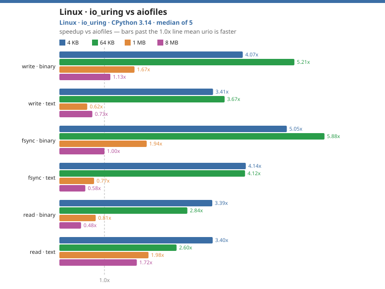
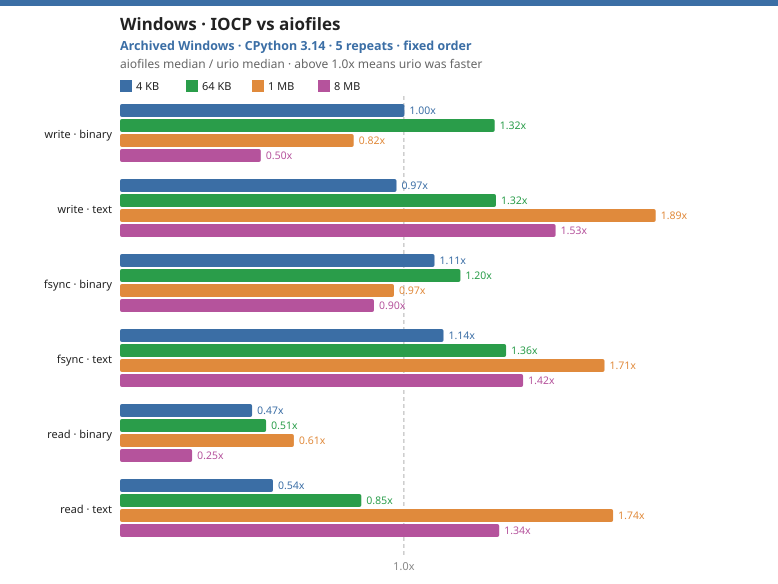
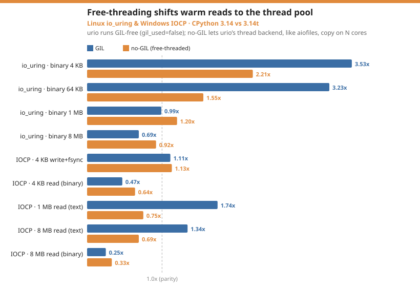

# Benchmarks

The repository includes `benchmarks/bench_vs_aiofiles.py`, which compares
urio with [aiofiles](https://github.com/Tinche/aiofiles). Each timing covers
a concurrent batch of file opens, an operation on each file, and closes.
It is wall-clock time for the batch, not latency per file. The charts show
the **ratio of median times**: aiofiles median divided by urio median.
A value above 1 means urio was faster in that run.

```console
python benchmarks/bench_vs_aiofiles.py --markdown
python benchmarks/bench_vs_aiofiles.py --repeat 9 --warmup 2 --json run.json
python benchmarks/bench_vs_aiofiles.py --reverse-order --json reverse.json
python benchmarks/bench_vs_aiofiles.py --stream-only --json stream.json
python benchmarks/bench_vs_aiofiles.py --cold
python benchmarks/bench_vs_aiofiles.py --directory /path/to/test-volume
```

On Linux, `--cold` requests cache eviction before reads.
The 2,000-file row needs a soft file descriptor limit above 2,064 on
POSIX systems. For example, run `ulimit -n 4096` in the shell first.
The runner checks this before it starts.
Use `--directory` to select the volume used for temporary files; the
runner removes its own files when it finishes.

## Run on GitHub Actions

The [Benchmark workflow](https://github.com/meitham/urio/actions/workflows/bench.yml)
uses six hosted runner types: Linux x64 and ARM64, macOS Intel and ARM64,
and Windows x64 and ARM64. Select a CPython version when starting it manually.
Pull requests that change the benchmark workflow or runner also exercise the
matrix with CPython 3.15. The workflow first tests the installed build.

Each runner measures binary and text operations at 4 KB (300 files), 64 KB
(150 files), 1 MB (40 files), and 8 MB (10 files), plus a single-file 128 MB
streaming read. Every workload runs in four separate processes with the
contender order forward, reverse, reverse, forward. Each process uses two
warmups and seven timed samples per contender. Windows selects the optional
IOCP backend so its JSON contains both IOCP and thread results. The workflow
uploads one raw JSON artifact per runner; each file records the exact Python
and dependency versions, code hashes, options, and all timed samples.

These runner types cover the common OS and CPU combinations, not every
environment urio supports. GitHub does not supply a standard 32-bit ARM
runner or the Raspberry Pi's storage; its Linux VM also does not reproduce a
particular ext4 or ZFS host. Compare contenders within a run, and check both
orders and run-to-run variation before making a performance claim. Do not
compare absolute times across runner types as if they were equivalent
hardware.

## Six hosted platforms, October 2026

The [24 October workflow run](https://github.com/meitham/urio/actions/runs/40078800225)
passed on all six runners with CPython 3.15.1. The table shows concurrent,
warm-cache binary reads. Each value is the smallest to largest ratio of four
process medians: aiofiles time divided by urio time. Values above 1 mean
urio was faster in those processes.

| Runner | urio backend | 4 KB, 300 files | 8 MB, 10 files |
|---|---|--:|--:|
| Linux x64 | io_uring | 4.85–5.19× | 0.39–0.44× |
| Linux ARM64 | io_uring | 3.95–4.06× | 0.27–0.35× |
| macOS Intel | thread | 0.92–1.07× | 0.89–1.06× |
| macOS ARM64 | thread | 0.76–1.19× | 0.87–1.07× |
| Windows x64 | IOCP | 0.61–0.64× | 0.29–0.31× |
| Windows ARM64 | IOCP | 0.53–0.58× | 0.32–0.51× |

Small Linux reads were faster, while 8 MB Linux reads were slower, in both
independent [workflow runs](https://github.com/meitham/urio/actions/runs/40077576945).
The macOS read comparisons are near parity or vary across processes. IOCP
was slower for concurrent small binary reads, but its 4 KB buffered writes
were faster in all four final processes on both Windows runners: 1.73–1.98×
on x64 and 1.21–1.42× on ARM64. The Windows x64 multipliers changed
substantially between the two runs, so the measured direction is more
reliable than any precise multiplier. These process ranges are not
confidence intervals.

The [benchmark archive](https://github.com/meitham/urio/releases/download/benchmarks-2026-10-24/urio-benchmarks-2026-10-24.zip)
contains both runs, including text, writes, `write + fsync`, streaming reads,
all timed samples, environment details, and artifact checksums. Its SHA-256
digest is recorded in the [archive notes](https://github.com/meitham/urio/blob/main/benchmarks/data/validation-2026-10-24/README.md).

## What the results can show

The Linux matrix uses 2,000 files at 4 KB, 500 at 64 KB, 100 at 1 MB,
and 20 at 8 MB. The Windows matrix uses 300, 150, 40, and 10 files.
File size, file count, and total bytes therefore change together.
Comparisons between urio and aiofiles *within* a row use the same
workload; differences *between* rows cannot be attributed to file size alone.

Read tests warm the working set before timing. Each contender writes to its
own files, but all share the machine's caches, CPU, and storage. The archived
runs always measured contenders in the same order. This can bias results;
the new `--reverse-order` option permits a sensitivity check. The October
2026 runs below include both orders. Buffered writes are especially affected
by writeback.

Most results have five repetitions in one process; ZFS has seven and ARM
has three. A median is useful for describing those runs, but it is not a
confidence interval. Small differences around 1.0 are not evidence that
one library is faster. The historical JSON also lacks the exact source
commit and dependency versions. The [raw samples](https://github.com/meitham/urio/tree/main/benchmarks/data)
are retained, and `scripts/plot_benchmarks.py` now generates the charts
directly from them.

`write + fsync` includes an `fsync` call for each file. It is not a
crash-consistency test: the benchmark does not sync parent directories
or verify what reached physical storage.

## Other current-source checks

The [October 2026 raw samples](https://github.com/meitham/urio/releases/download/benchmarks-2026-10-24/urio-benchmarks-2026-10-23.zip)
use the current 0.2.0 source and aiofiles 25.1.0. Each workload was run
in a separate process with the normal and reversed contender orders.
The following ratios compare the medians from each process; a value
above 1 means urio was faster in that process.

On a Linux host with ZFS, CPython 3.14.6, and the io_uring backend:

| Binary workload | Files | Normal order | Reverse order |
|---|--:|--:|--:|
| 4 KB read | 2,000 | 3.16× | 2.10× |
| 4 KB write + fsync | 2,000 | 2.90× | 3.01× |
| 64 KB read | 500 | 2.48× | 3.01× |
| 64 KB write + fsync | 500 | 1.41× | 1.45× |
| 8 MB read | 20 | 0.82× | 0.90× |
| 8 MB write + fsync | 20 | 1.03× | 1.03× |

The small-read and small-write advantages persisted when the order was
reversed. The 8 MB `write + fsync` comparison was near parity. On a Mac
with CPython 3.14.7, four separate runs of the thread backend and
aiofiles gave 4 KB read ratios of 0.93–1.01×. The 8 MB buffered-write
ratios ranged from 0.77× to 2.10×, so those runs do not establish a
winner for that operation. All measurements used warm-cache data and
machines running other services.

A [hosted ARM64 run](https://github.com/meitham/urio/actions/runs/40026586497)
used CPython 3.14.8 and the io_uring backend. Four independent processes
ran each binary workload in forward, reverse, reverse, forward order.
Across those processes, the 300-file 4 KB read ratio was 4.06–4.23×;
the 150-file 64 KB read ratio was 2.28–2.49×; and the 10-file 8 MB read
ratio was 0.31–0.38×. These are ranges of ratios of process medians, not
confidence intervals. The [raw ARM64 samples](https://github.com/meitham/urio/releases/download/benchmarks-2026-10-24/urio-benchmarks-2026-10-23.zip)
record the environment and all timed samples. This runner is a different
machine from the 32-bit Raspberry Pi used in the older ARM run.

## Earlier Linux io_uring run

The archived chart below uses CPython 3.14.6 on an Intel Core i5-6500 (4 cores),
32 GB RAM, ext4 on a SATA hard disk, and Linux 7.0. It shows concurrent,
warm-cache operations against aiofiles. These samples were collected in
one process, always with the same contender order; the exact source
commit was not recorded. Treat the chart as a record of that run.



Small and medium workloads had the largest advantages in this run:
4–64 KB buffered writes were 3.4–5.2 times faster, reads were
2.6–3.4 times faster, and `write + fsync` was 4.1–5.9 times faster.
Large warm binary reads were slower: about 0.8 times at 1 MB and
0.5 times at 8 MB. Large text writes also fell below parity.

For example, these are three cells behind the chart:

| Workload | Files | urio io_uring | aiofiles | Ratio |
|---|--:|--:|--:|--:|
| 4 KB binary read | 2,000 | 83.8 ms | 285.3 ms | 3.40× |
| 64 KB binary write + fsync | 500 | 17.0 ms | 100.1 ms | 5.89× |
| 8 MB binary read | 20 | 52.1 ms | 25.5 ms | 0.49× |

These timings include the whole batch. They do not measure individual
read or `fsync` latency.

### Attempted cold-cache reads

`--cold` calls `fsync` and `posix_fadvise(DONTNEED)` before each read.
This requests eviction; the benchmark does not verify cache misses.
On this machine the results remained close to the warm-cache results.
The 128 MB stream still ran at several GB/s, much faster than the disk,
so the data was apparently served from memory despite the eviction
request. These results should not be read as a measurement of physical
disk latency.

### The older ZFS run

The [archived ZFS samples](https://github.com/meitham/urio/blob/main/benchmarks/data/linux-x86_64-3.14-uring-zfs.json)
were collected on a different machine from the ext4 samples. The two
runs cannot isolate a filesystem effect. Some ZFS results also differ
substantially from the current-source ZFS check above: the older 64 KB
binary buffered-write ratio was 0.66×, compared with 2.83–3.50× in
the new forward and reverse runs. The source commit and dependency
versions for the older run are unavailable, so the cause of that change
cannot be determined from these samples.

## Windows IOCP

The [October 2026 hosted Windows run](https://github.com/meitham/urio/actions/runs/40026077281)
used CPython 3.14.9 on Windows Server 2025 with the current source.
The optional IOCP backend was selected explicitly. Each size was tested
in binary and text mode in four independent processes, in forward,
reverse, reverse, forward contender order, with seven timed samples per
contender. These are concurrent, warm-cache batch timings.

| Binary workload | Files | Buffered write | Write + fsync | Read |
|---|--:|--:|--:|--:|
| 4 KB | 300 | 1.65–1.94× | 0.77–1.38× | 0.53–0.57× |
| 64 KB | 150 | 1.74–1.97× | 1.11–2.09× | 0.55–0.71× |
| 8 MB | 10 | 0.55–0.62× | 0.97–1.08× | 0.27–0.67× |

Ranges show the smallest and largest ratios of process medians, not
confidence intervals. Small buffered writes were faster in both orders; binary
reads were slower with IOCP in every run. Several `write + fsync`
comparisons varied enough that a precise advantage is unresolved. The
[raw Windows samples](https://github.com/meitham/urio/releases/download/benchmarks-2026-10-24/urio-benchmarks-2026-10-23.zip)
include the text workloads and the individual timings. The 8 MB text-read
ratio was 0.81–0.82× in these four processes. This runner is a different
machine and Windows version from the one in the archived chart.

### Earlier Windows 10 run

The archived chart below uses an 8-core Windows 10 machine with CPython
3.14. The figures are medians of five runs in one process, all measured
in the same contender order. This machine has not been rerun with the
current source.



| Workload | Buffered write | Write + fsync | Read |
|---|--:|--:|--:|
| Binary, 4–64 KB | 1.00–1.32× | 1.11–1.20× | 0.47–0.51× |
| Binary, 1–8 MB | 0.50–0.82× | 0.90–0.97× | 0.25–0.61× |
| Text, 4–64 KB | 0.97–1.32× | 1.14–1.36× | 0.54–0.85× |
| Text, 1–8 MB | 1.53–1.89× | 1.42–1.71× | 1.34–1.74× |

Some Windows rows have wide sample ranges. In the 4 KB binary-write row,
both medians were about 113 ms; the 1.00× ratio indicates no measured
advantage. The larger read differences are clearer in these samples.

Concurrent binary reads were slower with IOCP in both the archived run
and the hosted check. The benchmark does not isolate the cause. Windows
uses the thread backend by default; IOCP is available with
`URIO_WINDOWS_IOCP=1`.

## Earlier ARM run

A Jetson Nano (aarch64, Linux 4.9, CPython 3.12) used the thread
backend because its kernel predates io_uring. The manylinux2014 wheel
ran on its glibc 2.27 system. The earlier Jetson measurements have no
saved samples in this repository, so they are omitted here.

A Raspberry Pi running 32-bit ARM, Linux 5.15, and CPython 3.12 used
io_uring. The table shows medians of three warm-cache runs:

| Scenario | Write | Write + fsync | Read |
|---|--:|--:|--:|
| 300 × 4 KB binary | 0.22× | 1.36× | 2.89× |
| 300 × 4 KB text | 1.35× | 2.07× | 2.18× |
| 150 × 64 KB binary | 2.21× | 2.43× | 2.30× |
| 150 × 64 KB text | 1.18× | 0.63× | 2.33× |
| 20 × 1 MB binary | 0.35× | 0.77× | 0.49× |

The ARM measurements have only three repetitions and many wide ranges.
The 0.22× buffered-write result varied widely, possibly because of
writeback on the SD card.
Use these rows as exploratory measurements, not expected Pi performance.

## Earlier free-threaded runs

Free-threaded Python changes how much work an executor can do in
parallel. The following Linux results compare CPython 3.14.6 and
3.14.6t on the same 4-core machine. They are concurrent, warm-cache
binary reads.



| Size | 3.14.6 | 3.14.6t |
|---|--:|--:|
| 4 KB | 3.40× | 2.24× |
| 64 KB | 2.88× | 1.60× |
| 1 MB | 0.81× | 0.97× |
| 8 MB | 0.49× | 1.22× |

The ratio narrowed for small reads, and the 8 MB result moved above
parity in this run. These measurements cannot separate interpreter
effects from run-to-run variation. A separate 3.15.0b3t
run is retained in the raw results; it should not be treated as a
measurement of the final 3.15 release.

On the Windows IOCP machine, the comparison between CPython 3.14 and
3.14t showed a different effect for large text reads:

| Size | Operation | 3.14 | 3.14t |
|---|---|--:|--:|
| 4 KB | Binary write + fsync | 1.11× | 1.13× |
| 64 KB | Binary write + fsync | 1.20× | 1.08× |
| 4 KB | Binary read | 0.47× | 0.64× |
| 8 MB | Binary read | 0.25× | 0.33× |
| 1 MB | Text read | 1.74× | 0.75× |
| 8 MB | Text read | 1.34× | 0.69× |

The measurements do not isolate why the ratios changed. In particular,
the large text-read result has not been checked with independent runs
and reversed contender order. Measure your own mix of reads, writes,
and syncs before choosing IOCP or forcing the thread backend.
