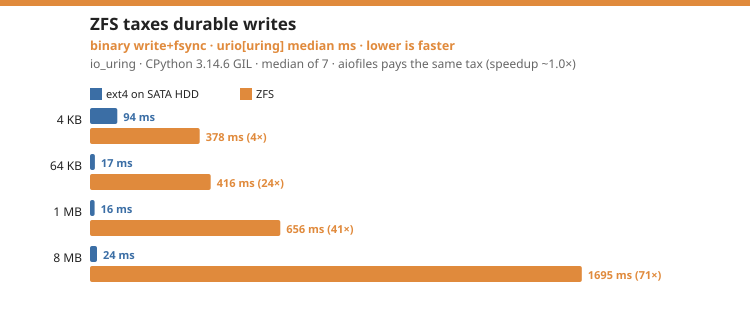

# Benchmarks

urio ships a benchmark comparing both backends against
[aiofiles](https://github.com/Tinche/aiofiles) across file sizes, in **both
binary and text mode**:

```bash
python benchmarks/bench_vs_aiofiles.py                  # human-readable
python benchmarks/bench_vs_aiofiles.py --markdown        # raw numbers (tables)
python benchmarks/bench_vs_aiofiles.py --mode binary     # binary only
python benchmarks/bench_vs_aiofiles.py --cold            # evict cache before reads
python benchmarks/bench_vs_aiofiles.py --files 1000 --size 65536 --repeat 7
```

The charts below are rendered from a representative run by
`scripts/plot_benchmarks.py`; re-run the benchmark for raw numbers.

## Fairness

A microbenchmark is only as honest as its setup, so the harness goes out of its
way to give every contender identical conditions:

- **Warm cache for everyone.** Before any read is timed, the whole working set
  is pulled into the page cache with a neutral synchronous reader, and each
  contender additionally gets untimed warm-up runs. Nobody is measured cold
  while another is measured warm.
- **Per-contender isolation.** Each contender writes to its **own** set of
  files, so it never inherits another contender's dirty pages or writeback
  pressure — the order in which contenders run cannot advantage any of them.
- **Median, not minimum.** Times are the **median** of N timed runs, with the
  **[min–max] range** shown so run-to-run variance is visible rather than hidden
  by a single luckiest minimum. Every raw sample is retained (`--json`), so
  mean/best/percentiles can be derived later without re-running.
- **Binary and text.** Every scenario runs twice: once in binary mode (the raw
  positional path) and once in text mode (the codec + newline-translation path).
- **Buffered and durable writes.** Each write scenario is measured twice: a
  plain buffered `write` (lands in the page cache) and a `write+fsync` that
  forces the data to disk through each library's natural path — urio via its
  async `fsync()` (io_uring `IORING_OP_FSYNC` on the uring backend, `os.fsync`
  in the executor on the thread backend), aiofiles by flushing and `os.fsync`'ing
  its fd. Durable writes are far more reproducible because the device, not the
  cache, sets the pace.
- **Concurrent.** Each scenario opens/operates/closes many files at once — the
  regime where not parking a thread per operation can matter.

!!! warning "These numbers are noisy and machine-specific"
    The figures below are a single run on a shared Linux development machine.
    Buffered writes in particular swing a lot run to run because they become
    bound by kernel writeback. Treat the **shape** of the results as the
    takeaway, not the exact multipliers — and run it on your own hardware.

!!! note "Test hardware"
    Unless a chart says otherwise, all Linux numbers on this page were measured on
    one box:

    | | |
    |---|---|
    | **CPU** | Intel Core i5-6500 (Skylake), 4 cores / 4 threads, 3.2 GHz base (3.6 GHz turbo) |
    | **RAM** | 32 GB |
    | **Storage** | `/data`: Toshiba DT02ABA200 SATA **HDD** (spinning disk), ext4 |
    | **OS / kernel** | Ubuntu 26.04 LTS, Linux 7.0 |
    | **Python** | CPython 3.14.6 (GIL); 3.14.6t and 3.15.0b3t (free-threaded) |

    The spinning disk matters for the [cold-cache](#cold-cache-cold) reading:
    with 32 GB of RAM and small working sets, even `--cold` reads are served from
    the page cache, not the platter. Windows IOCP numbers are from a separate
    Windows 10/11 8-core box; the free-threading ZFS comparison and the ARM/macOS
    rows name their own hardware inline.

## Results

Median of 7 timed runs (after warm-up) on the Linux box above (see **Test
hardware**), CPython **3.14.6**. Every bar is one `operation × mode × size`, coloured by file
size; a bar past the 1.0× line means urio[uring] is faster than aiofiles
(`aiofiles ÷ urio[uring]`), short of it means slower. `urio[thread]` tracks
aiofiles closely throughout, so the chart focuses on the io_uring backend.


- **Buffered writes** win at every size up to large — submission batching for
  small/medium files (one `io_uring_enter` per loop tick instead of one syscall
  per op) for **2.9–5.3×** at 4–64 KB, and zero-copy submission for large binary
  ones (**1.5× at 1 MB, parity at 8 MB**; the caller's Python `bytes` is handed
  to the kernel with no per-write `memcpy`). Large *text* writes trail (they
  re-encode before submitting).
- **Durable writes** (`write + fsync`) converge on disk bandwidth — small/medium
  files still win big on batched `fsync` (**3.9–5.8×**), large binary stays
  ahead (**1.0–2.0×**), large text dips below it.
- **Warm reads** win small/medium (**2.6–3.5×**, where aiofiles' pool starves
  under concurrency) and now hold up at large sizes too: reads are **zero-copy**
  (the kernel fills the returned `bytes` directly, no second `memcpy`) and big
  reads are punted to io-wq workers so their page-cache copies run on multiple
  cores — large *binary* lands at **1.0× (1 MB) / 0.7× (8 MB)** (formerly
  0.3–0.5×) and large *text* wins (**1.1–1.4×**).
- **Streaming** a 128 MB file in 1 MB chunks now runs well past the pool:
  binary **6447 MB/s vs aiofiles's 3329 (1.9×)**, text 2249 vs 1783 (**1.3×**) —
  the zero-copy read path turned what used to be a bandwidth-bound wash into a
  clear win.

## Cold cache (`--cold`)

The reads above hit a warm page cache — the *worst* case for io_uring, since a
warm read is a pure `memcpy` a thread pool can spread across cores. The `--cold`
flag evicts each file (`fsync` + `posix_fadvise(DONTNEED)`) before every timed
read, so reads hit storage — io_uring's intended domain.

**Honest result: cold-cache reads land at essentially the same shape as warm —
small/medium win, large binary trails** (binary 4 KB **3.1×**, 64 KB **2.3×**,
1 MB **0.76×**, 8 MB **0.64×**; the 128 MB cold stream runs **2.0×**). Two
reasons, both worth knowing:

1. **The reads never actually reach the platter.** `/data` is a spinning HDD,
   but the box has 32 GB of RAM and the working sets are small, so even after
   `fadvise(DONTNEED)` the "evicted" data comes straight back from the page cache
   — the 128 MB cold stream still runs at multi-GB/s, i.e. from RAM, not a disk
   that tops out near ~150 MB/s. So there is no read *latency* for io_uring to
   hide (it hides latency, not bandwidth). io_uring's real win needs genuinely
   latency-bound storage — a loaded disk, network filesystem, or high queue depth
   that actually misses cache — which this small-working-set setup never induces.
2. **At these sizes reads are dominated by per-op and copy cost, not I/O wait.**
   So cache state barely moves them, and the warm shape carries straight over:
   small/medium win (per-op batching), large binary trails (many concurrent
   copies saturate memory bandwidth wherever they run).

So cold testing did not flip the read story on this hardware; it confirmed
*where* the real costs are. The durable-write and high-concurrency write wins
(below) remain the dependable advantages.

## Filesystem impact: ext4 vs ZFS

The numbers above are ext4 on a SATA HDD. Running the **same urio build** (GIL,
CPython 3.14.6, warm, median of 7) on a second Linux box backed by **ZFS** shows
one operation change character completely: **durable writes**.



On ZFS every `fsync` forces a ZIL + transaction-group commit, so `write+fsync`
latency explodes with size — `urio[uring]` 64 KB **17 → 416 ms**, 1 MB **16 →
656 ms**, 8 MB **24 → 1695 ms** (24–71× slower than ext4). Three things make this
honest rather than alarming:

- **It is the filesystem's cost, not urio's.** aiofiles pays the *identical* ZIL
  tax on the same box, so urio's **speedup vs aiofiles stays ~1.0×** on the large
  durable writes — the bar chart above is absolute milliseconds precisely because
  the speedup ratio hides the effect. And **many-small-file durability still wins
  big** (4 KB `write+fsync` **2.4×**, 378 vs 902 ms): aiofiles issues thousands of
  individual `fsync`s while urio batches them into one `IORING_OP_FSYNC` sweep, a
  gap ZFS's per-commit cost actually *widens*.
- **Durable writes are the systematic change.** Small/medium reads still win big
  (4 KB **3.3×**, 64 KB **4.3×**); ZFS's ARC even *absorbs* 1 MB buffered writes
  (**17 → 12 ms**), though buffered writes overall are noisier here under txg
  pressure.
- **This is a ZFS data point, not a clean A/B.** The ZFS box is also a different
  CPU (8-thread Xeon vs 4-core i5), RAM, and kernel — and a live Proxmox host —
  so treat it as "here is how urio behaves on ZFS," not an isolated filesystem
  benchmark.

The practical rule: on a copy-on-write filesystem like ZFS, `fsync`-heavy
workloads are bound by the commit, not the async library — reach for urio's
batched `fsync` when you have **many** files to make durable, and expect large
single-file durable writes to converge with everything else on the device.

## Real-world workload: Sanic static file serving

Microbenchmarks isolate the I/O layer; this section measures urio inside
someone else's production code. [Sanic](https://sanic.dev) serves every
`app.static` file through `aiofiles.open` (via the module-global
`sanic.compat.aio_open`), so rebinding **one name at runtime** —
`sanic.compat.aio_open = urio.open` — swaps the file layer of a major web
framework with no source patched: `urio.open` is awaitable and an async
context manager exactly like aiofiles'.

Method: Sanic 25.12.1, single process, access log off; an aiohttp load
generator on the same machine with 32 concurrent connections; 100-request
warm-up (warm page cache), then 12-second timed runs, median of 3; served
bodies verified byte-identical (md5) to the on-disk files in both modes.
CPython 3.12 throughout. Requests per second, `urio ÷ aiofiles` as the ratio:

**4-core Intel i5-6500 (Skylake), Linux, ext4 — urio on io_uring:**

| File | aiofiles | urio | ratio |
|---|--:|--:|--:|
| 4 KB | 1,719 | 2,258 | **1.31×** |
| 64 KB | 1,678 | 2,133 | **1.27×** |
| 1 MB | 866 | 889 | 1.03× |

**8-thread Intel Xeon E5-1620, Linux, ZFS — urio on io_uring:**

| File | aiofiles | urio | ratio |
|---|--:|--:|--:|
| 4 KB | 1,262 | 1,619 | **1.28×** |
| 64 KB | 1,206 | 1,504 | **1.25×** |
| 1 MB | 616 | 661 | 1.07× |

**14-core Apple M4 Pro, macOS — urio on the thread backend:**

| File | aiofiles | urio | ratio |
|---|--:|--:|--:|
| 4 KB | 4,524 | 4,694 | 1.04× |
| 64 KB | 4,300 | 4,451 | 1.04× |
| 1 MB | 3,175 | 3,219 | 1.01× |

Three things worth reading out of the numbers:

- **The win is per-op cost, not copy bandwidth — so more cores do not rescue
  the thread pool.** A plausible objection is that a 4-core box starves
  aiofiles' executor and a bigger CPU would close the gap. The 8-thread box
  answers it: the ratio barely moves (1.31×/1.27× → 1.28×/1.25×). Each
  request costs aiofiles open + read(s) + close, each a GIL-mediated thread
  hop, and extra cores don't make those hops cheaper — while urio batches
  them into the ring. Median latency drops accordingly (4 KB p50 18.7 → 14.3
  ms on the 4-core box, 24.3 → 19.3 ms on the 8-thread box).
- **At 1 MB both modes converge** — the Python HTTP client and server stack
  becomes the bottleneck (~900 MB/s through the loopback on the 4-core box),
  so the file layer stops mattering. That row is a floor on urio's benefit,
  not a ceiling.
- **On macOS urio runs its thread backend and lands at parity or a few
  percent ahead** (its read path is a single `FileIO.readall` executor hop) —
  swapping urio in never costs anything on platforms without a native
  backend.

The same swap-and-measure exercise on
[aiologger](https://github.com/async-worker/aiologger)'s unmodified
`AsyncFileHandler` (an awaited write+flush per log record) gave 2.3×
sequentially and 5.2× with 100 concurrent writers on the 4-core io_uring box
— the per-op story, amplified.

!!! note "The same opportunity exists beyond aiofiles"
    Frameworks that moved off aiofiles didn't move off thread pools:
    [anyio](https://anyio.readthedocs.io/)'s `Path` and `open_file` — what
    Starlette and FastAPI use for static files — dispatch every file
    operation to a worker thread via `to_thread.run_sync`. An
    io_uring-backed file layer could slot in there just as it does for
    aiofiles; today that means using `urio.open`/`urio.Path` directly in
    application code.

## Windows (IOCP backend)

The Windows [IOCP backend](getting-started/backends.md) is production-validated on
Windows 10/11 (CPython **3.14**, GIL and free-threaded): the full test suite
(190 tests, including the differential suite against the stdlib `io` oracles)
and a concurrency + cancellation + error-path stress test both pass. Getting there fixed three cross-platform Windows correctness bugs — every
fd is now opened `O_BINARY` (without it the CRT runs in text mode and
`os.read`/`os.write` translate CRLF, corrupting binary data and desyncing
offsets), `Path.replace()` overwrites via `os.replace` (`os.rename` fails on
Windows if the target exists), and IOCP exclusive-create uses `CREATE_NEW`
(`O_EXCL` / `'x'` mode now raises `FileExistsError`).


Measured against aiofiles (**median of 5**, warm cache, concurrent, CPython 3.14),
as a speedup (`aiofiles ÷ urio[iocp]`, >1 means urio is faster):

| Workload | buffered write | write+fsync | read |
|---|--:|--:|--:|
| binary, small/med (4–64 KB) | 1.00–1.32× | 1.11–1.20× | 0.47–0.51× |
| binary, large (1–8 MB) | 0.50–0.82× | 0.90–0.97× | 0.25–0.61× |
| text, small/med (4–64 KB) | 0.97–1.32× | 1.14–1.36× | 0.54–0.85× |
| text, large (1–8 MB) | 1.53–1.89× | 1.42–1.71× | **1.34–1.74×** |

So urio[iocp] is **at parity-to-winning on buffered writes** (zero-copy writes,
the same technique as the io_uring backend; only large *binary* buffered writes
soften), **wins on durable writes** except large binary (~0.9×), and — with
reads now **zero-copy** too (the kernel fills the returned `bytes` directly) —
**wins large text outright** (1.3–1.9× across write/fsync/read; streaming a
128 MB binary file runs 2.1 GB/s vs aiofiles' 1.5). The loss that remains is
**binary reads** (0.25–0.61×).

The binary-read loss is structural on Windows: a warm-cache overlapped
`ReadFile` completes *synchronously*, so the kernel performs the copy inline on
the submitting loop thread — one core — while aiofiles' pool runs N copies in
parallel. Zero-copy reads removed the second (Python-side) copy, which is why
streaming and text flipped to wins, but the inline kernel copy remains
single-threaded. A single 8 MB file reads at parity with aiofiles; the gap opens
under concurrency.

**How completions are reaped (the key design).** urio reaps completions **on the
event-loop thread**, the Windows analogue of the Linux eventfd design — no poller
thread, no `call_soon_threadsafe`. asyncio's `ProactorEventLoop` already owns an
I/O completion port and blocks on it; urio opens files with overlapped I/O,
associates them with *that* port, and submits reads/writes (with offsets, which
the stock `_overlapped` module cannot express) through a small native object that
registers each op with the proactor. When the kernel posts a completion the loop
wakes itself and resolves the future inline — a per-op round-trip floor of
**~41 µs**. On non-`ProactorEventLoop` loops (e.g. `SelectorEventLoop`) urio
falls back to a single poller thread that reaps completions in batches
(`GetQueuedCompletionStatusEx`) and delivers each batch with one
`call_soon_threadsafe`.

Concurrent binary reads are the weakest case (down to ~0.25× at 8 MB) for that
inline-copy reason; writes and durable writes are competitive and large text now
wins. The backend stays opt-in (`URIO_WINDOWS_IOCP=1`) and Windows defaults to
the thread pool — binary reads are the deciding factor, and the thread pool
spreads the read copy across cores.

## ARM / aarch64 (Jetson Nano — thread fallback)

urio is validated on a **Jetson Nano** (aarch64, Ubuntu 18.04, Tegra X1 4-core).
Its kernel is 4.9, which predates io_uring, so urio automatically falls back to
the **thread backend** — the intended behaviour on old kernels — and the
`manylinux2014` aarch64 wheel installs and runs on glibc 2.27.

Here the comparison is `urio[thread]` vs aiofiles (best of 3, warm cache,
concurrent), as a speedup (`aiofiles ÷ urio[thread]`, >1 means urio is faster):

| Size | binary write | binary read | text write | text read |
|---|--:|--:|--:|--:|
| 4 KB | 0.96× | 1.02× | 0.97× | 1.18× |
| 64 KB | 1.07× | 1.07× | 0.97× | 1.05× |
| 1 MB | 0.94× | 1.04× | **1.90×** | 0.65× |
| 8 MB | 0.77× | 0.53× | 1.04× | 0.98× |

Durable (`fsync`) writes land at 0.88–1.11×. The headline is that **the thread
backend tracks aiofiles within ~±10% on ARM**, as designed — it is the same
thread-pool strategy — while urio's text-write coalescing still wins on large
text writes (1.9×). The slower spots are large warm reads (executor copy on a
slow microSD), the same `memcpy`-bound shape seen elsewhere. (On a newer-kernel
ARM box, urio would instead use the native io_uring backend.)

## 32-bit ARM io_uring (Raspberry Pi)

io_uring also runs on **32-bit ARM**. On a Raspberry Pi (armv7l, kernel
5.15, CPython 3.12) urio uses its **native io_uring backend** — validated correct
(read/write/fsync/concurrency) and faster than aiofiles on the workloads that
matter on a small box. Median of 3, warm, concurrent
(`aiofiles ÷ urio[uring]`; raw samples in `benchmarks/data/linux-armv7l-*.json`):

| Scenario | write | write+fsync | read |
|---|--:|--:|--:|
| 300 × 4 KB binary | 0.22׆ | 1.36× | **2.89×** |
| 300 × 4 KB text | 1.35× | **2.07×** | **2.18×** |
| 150 × 64 KB binary | **2.21×** | **2.43×** | **2.30×** |
| 150 × 64 KB text | 1.18× | 0.63× | **2.33×** |
| 20 × 1 MB binary | 0.35× | 0.77× | 0.49× |

The dependable win is **reads: 2.2–2.9×** across small/medium files — larger than
on x86, because on a weak, RAM-starved Pi the thread pool contends hardest while
urio's single loop thread plus io_uring sails through. Small/medium **durable
writes** also win (up to 2.4×): one batched `IORING_OP_FSYNC` sweep versus
aiofiles' hundreds of executor `fsync`s on a slow microSD. **Large (1 MB)** files
flip to a loss (0.4–0.8×) — few files, no concurrency to exploit, throughput- and
`memcpy`-bound. Buffered writes are **very noisy** on this SD card (†the 300×4 KB
binary `0.22×` is a writeback outlier — the `fsync` rows are the reliable write
metric). Working sets are kept small (the box has ~470 MB free).

Build note: the `io-uring` crate ships no 32-bit-ARM syscall bindings, so the
armv7 wheel is built with `RUSTFLAGS=--cfg io_uring_skip_arch_check` — safe
because the io_uring ABI structs are fixed-width, and validated on this Pi.

## Free-threaded Python (no-GIL) changes the read story

Free-threaded CPython (PEP 703, the `t` builds) removes the GIL, and that
reshapes the warm-cache comparison. **urio runs GIL-free too** — the native
module declares free-threaded support (`gil_used = false`), and the three native
classes are `#[pyclass(unsendable)]`, so each ring stays confined to its
event-loop thread. Crucially, **urio has the same thread-pool mode aiofiles
does**: its `thread` backend runs the blocking syscalls in the loop's executor,
so under no-GIL its warm-read copies parallelise across all cores *identically*.
So this is not urio "losing" free-threading — you keep io_uring/IOCP for the
write, `fsync`, and latency wins, and drop to urio's thread backend for warm
reads, where it matches aiofiles. What the numbers below isolate is only the
*native* backends' warm-read edge — the advantage a single loop thread held over
a **GIL-bound** pool — narrowing as that pool is unshackled.

Measured on the **same** interpreter version, GIL vs no-GIL (CPython 3.14.6 vs
3.14.6t, x86_64 4-core), binary **reads**, as a speedup
(`aiofiles ÷ urio[uring]`):

The chart below pairs the Linux io_uring rows with the Windows IOCP rows
(detailed [below](#windows-iocp-under-no-gil-reads-lose-writes-hold)) — the same
free-threading effect shows on both backends: GIL (blue) vs no-GIL (orange),
speedup vs aiofiles.


| read size | GIL | no-GIL | aiofiles ms (GIL → no-GIL) |
|---|--:|--:|--:|
| 4 KB | **3.53×** | **2.21×** | 287 → 176 |
| 64 KB | **3.23×** | **1.55×** | 72 → 42 |
| 1 MB | 0.99× | **1.20×** | 26 → 27 |
| 8 MB | 0.69× | 0.92× | 25 → 28 |

**Free-threading narrows urio[uring]'s small/medium warm-read edge — but it now
stays a clear win at every size.** With no GIL, aiofiles and `urio[thread]` copy
read data into Python `bytes` **in parallel across all cores**, so their small
reads speed up sharply exactly where a GIL-bound pool was starving — aiofiles
4 KB 287 → 176 ms, 64 KB 72 → 42 ms — and the small-read multiplier compresses
(4 KB 3.53× → 2.21×, 64 KB 3.23× → 1.55×). Large reads used to be the story's
weak spot; with **zero-copy reads** (the kernel fills the returned `bytes`
directly) plus the io-wq punt for ≥1 MB reads, they sit at **parity under the
GIL and slightly ahead without it** (1 MB 0.99× → 1.20×, 8 MB 0.69× → 0.92×) —
free-threaded CPython's costlier refcounting hurts the pool more than the ring.
(3.15.0b3t sharpens the picture further: binary reads win at **every** size —
4 KB 1.77×, 64 KB 1.38×, 1 MB 1.14×, 8 MB 1.31× — while small/medium `fsync`
stays a 2.1–2.5× io_uring win.)

Writes are unaffected: urio's **submission batching still wins** on small/medium
buffered writes under no-GIL (~1.1–2.2×), because that path is syscall-bound, not
copy-bound. And urio's *own* thread backend speeds up **exactly like aiofiles**
(same executor strategy) — so the practical rule on free-threaded Python is
**reads favour the thread pool, writes favour io_uring**, and urio gives you
both: drop to its thread backend for warm reads (parity with aiofiles), keep
io_uring for writes.

**Takeaway:** urio is free-threaded-ready and, like aiofiles, drops to a
parallelised thread pool for warm reads. Free-threading narrows only the
*native* backends' warm-cache *read* edge (the weakest, `memcpy`-bound case); the
durable advantages remain **write batching** and **latency-bound / cold I/O** —
and for warm reads you simply use the thread backend, losing nothing to aiofiles.

!!! note "Python version support"
    Validated free-threaded on **3.14t and 3.15.0b3t**. **PyO3 0.29** (urio's
    binding) supports the free-threaded build only from **3.14 onward** — it
    refuses to compile against 3.13t — so 3.14t is urio's free-threaded floor.
    io_uring loads and read/write round-trips are correct on both.

### Windows IOCP under no-GIL — reads lose, writes hold

The IOCP backend reaps and copies each read on the single event-loop thread (the
ProactorEventLoop design above), while aiofiles' pool — and urio's own thread
backend — fan the copy across cores. So IOCP's characteristic weakness is
**reads**, and free-threading deepens it. These are the `IOCP ·` rows in the
[free-threading chart above](#free-threaded-python-no-gil-changes-the-read-story).

Median of 5 on Windows 10 (8-core), CPython **3.14 (GIL) vs 3.14t (no-GIL)**, same
zero-copy IOCP build, against aiofiles (`aiofiles ÷ urio[iocp]`, >1 means urio is
faster):

| Size | Op | GIL | no-GIL |
|---|---|--:|--:|
| 4 KB | write+fsync (binary) | 1.11× | 1.13× |
| 64 KB | write+fsync (binary) | 1.20× | 1.08× |
| 4 KB | read (binary) | 0.47× | 0.64× |
| 8 MB | read (binary) | 0.25× | 0.33× |
| 1 MB | read (text) | 1.74× | 0.75× |
| 8 MB | read (text) | 1.34× | 0.69× |

**IOCP wins on durable writes and loses on binary reads — and free-threading's
clearest effect is on _text_ reads.** Binary reads lose in both GIL states
(0.47× → 0.64×, 0.25× → 0.33× — the warm `ReadFile` copy completes inline on
the loop thread). But large text reads, which **win under the GIL** (1.34–1.74×
since zero-copy reads landed), drop to **~0.7× without it** — free-threading
lets aiofiles' pool *and* urio's own thread backend run the decode + copy across
all cores, while IOCP's reap stays on the loop thread. Durable small writes hold
(1.11× → 1.13×). The binary-read loss is inherent to the loop-thread design,
which is why IOCP remains opt-in.

**The thread backend, by contrast, tracks aiofiles everywhere.** Two design
choices make it hold up under free-threading. Writes go through an unbuffered
`io.FileIO` rather than `os.write` (which on Windows is ~7× slower for large
buffers), keeping binary writes at parity. And the text codec (encode/decode +
newline translation), which otherwise runs on the single loop thread, is
**offloaded to the executor for payloads ≥32 KiB on free-threaded interpreters**
(inline under the GIL, where the hop would only add latency) — so concurrent
files' codecs parallelise across cores. The thread backend's no-GIL reads then
track aiofiles: 1 MB text read **0.92×**, 8 MB text read **0.98×**, 8 MB binary
read **0.88×**, 1 MB binary read **1.09×**; text and binary writes are ~parity
(8 MB binary write **0.93×**, text writes 0.97–1.01×).

**Practical rule on free-threaded Windows: prefer urio's thread backend for
read-heavy work.** The thread backend is at parity with aiofiles for both
binary and text; IOCP's loop-thread reaping is an asset under the GIL (no
cross-thread hop, and it keeps its durable-write edge — 1.13× — even without
the GIL) and a liability for copy/codec-bound reads without it. This mirrors
the Linux result — free-threading favours the thread pool for copy/codec-bound
work. IOCP stays opt-in; the thread pool remains the Windows default.

## Durable writes converge on the device

For `write+fsync`, urio and aiofiles land in the same band — `fsync` makes the
storage device the bottleneck, so the async library stops mattering. urio is
competitive throughout and faster on some sizes; differences sit within
run-to-run noise on a shared machine. Reproduce on your own hardware:

```bash
python benchmarks/bench_vs_aiofiles.py --repeat 9 --warmup 2
```

## A few mechanics behind the numbers

**Why writes win.** Every queued operation reaches the kernel in a single
`io_uring_enter` per event-loop tick instead of one syscall per op — a
500-write workload issues ~15 enters, not 1500 — and large writes point the
kernel at the caller's Python `bytes` directly, with no per-write `memcpy`.
Large *text* writes trail because they re-encode before submitting.

**Why reads hold up.** The kernel writes into an uninitialised Python `bytes`
that is handed back as-is (no `memset`, no second copy — only the bytes
actually read are ever exposed), and reads of 1 MB and up are punted to io-wq
workers so concurrent warm-cache copies run on multiple cores. That is what
moved large binary reads from 0.3–0.5× to parity-ish and flipped streaming to
a win.

**`writelines` is one submission.** The whole batch goes to the ring as a
single vectored `writev`, so it pays one round-trip instead of one per line —
the saving scales with the number of lines.

**Sized text `read(n)` is one round-trip.** It requests the whole remaining
deficit from the raw layer in one go (matching the binary path); what remains
is the incremental Python decode. Line-oriented text iteration refills a
128 KB chunk per round-trip and decodes incrementally, so streaming a large
text file line by line trails a C `TextIOWrapper` — read binary and
bulk-decode if text line-streaming throughput is critical.

**The thread backend tracks aiofiles — reads and writes, every platform.** It
is the same thread-pool strategy aiofiles pioneered, and it is what urio uses
where no native backend is available or selected. Both reads and writes go
through `io.FileIO`, the same C-level object a Python file wraps.

## Takeaways

- Reach for urio's io_uring backend for **high-concurrency reads and writes,
  durable writes**, and workloads bound by **I/O latency**.
- Since reads became zero-copy (the kernel fills the returned `bytes` directly,
  large reads fanned out to io-wq workers), reads are **faster-to-parity across
  the board on Linux** — the one soft spot left is many *concurrent* 8 MB warm
  reads (~0.7×), which saturate memory bandwidth wherever they run. On Windows
  the IOCP read copy is still loop-thread-bound, which is why IOCP stays opt-in.
- One API, the best available backend at runtime — and a benchmark you can rerun
  on your own hardware to see where you land.
